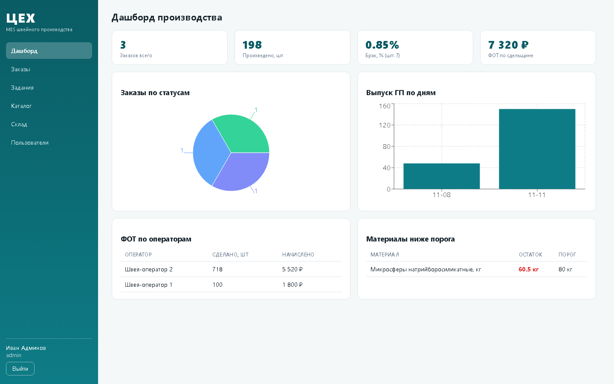
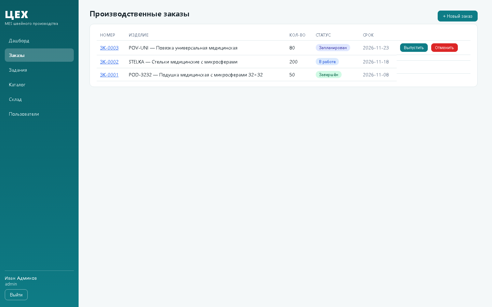
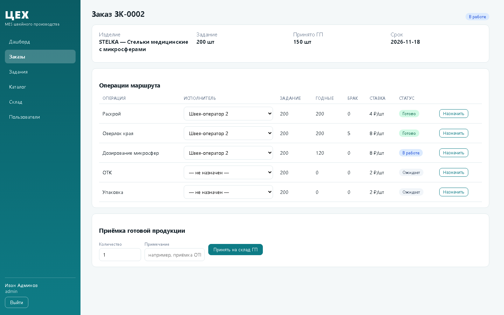
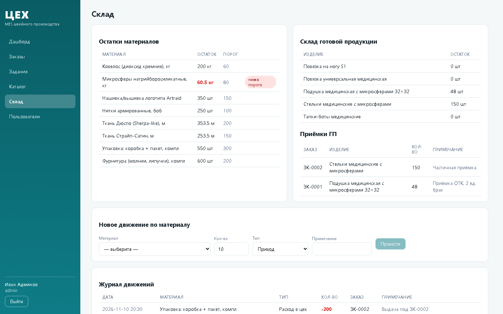

# Цех — MES для швейного производства (демо)

> Демо-проект под вакансию **fullstack-разработчик автоматизации производства** (Артрейд / НПО ТехПродЗдрав, hirehi.ru). Вся доменная модель — реальное швейное производство медицинских изделий с микросферами: раскрой → пошив → вышивка → дозирование → ОТК → упаковка → склад ГП.
>
> 🌐 **Live (фронтенд на Cloudflare Pages/Workers):** https://tsekh-demo.dvybornyh332.workers.dev — для работы API нужен запущенный backend (см. ниже), либо задайте `VITE_API_URL` при сборке.
> 📦 **GitHub:** https://github.com/zigih-1212/tsekh-mes-demo

## Скриншоты






## Что умеет

- Каталог изделий с **BOM** (материалы на единицу) и **маршрутом** (операции, участки, норма времени, сдельная ставка)
- Производственные заказы (ЗК-0001…): выпуск со **складским контролем**, задания по маршруту, приёмка ГП частями
- Склад материалов (знаковые движения, пороги, алерты) и склад готовой продукции
- Дашборд: статусы заказов, выпуск по дням, % брака, ФОТ по операторам
- 6 ролей с разграничением прав (admin, director, technologist, storekeeper, foreman, operator), JWT-аутентификация

## Структура репозитория

```
tsekh-demo/
├── backend/            # FastAPI + SQLAlchemy + SQLite, JWT, pytest (21 тест)
│   ├── app/            # models, routers, seed, main
│   └── tests/
├── frontend/           # React 19 + TS + Vite, react-query, recharts
│   └── src/pages/      # Login, Dashboard, Orders, Tasks, Catalog, Warehouse, Users
├── docs/
│   ├── ADR-001-erpnext.md   # что из ERPNext использовать/доработать/заменить
│   └── WALKTHROUGH.md       # разбор архитектуры для собеседования
└── README.md
```

Система объединяет планирование → производство → склад готовой продукции в одном веб-приложении
с ролями: администратор, директор, технолог, кладовщик, мастер, оператор.

## Стек

- **Backend:** Python 3.12, FastAPI, SQLAlchemy 2.0 (sync), SQLite, Pydantic v2, PyJWT, bcrypt
- **Frontend:** React 19 + TypeScript + Vite, react-router-dom, @tanstack/react-query, axios, recharts
- **Тесты:** pytest + httpx (TestClient) — 21 тест

## Быстрый старт

```bash
# backend
cd backend
python -m venv .venv
.\.venv\Scripts\pip install -r requirements.txt
.\.venv\Scripts\python -m uvicorn app.main:app --port 8000

# frontend (в другом терминале)
cd frontend
npm install
npm run dev   # http://localhost:5173, прокси /api -> :8000

# тесты
cd backend
.\.venv\Scripts\python -m pytest tests -q
```

При первом старте backend создаёт `tsekh.db` и наполняет его демо-данными (seed).

## Демо-пользователи

| Роль | Email | Пароль |
|---|---|---|
| Администратор | admin@artraid.demo | admin123 |
| Директор | director@artraid.demo | demo1234 |
| Технолог | tech@artraid.demo | demo1234 |
| Кладовщик | store@artraid.demo | demo1234 |
| Мастер | foreman@artraid.demo | demo1234 |
| Оператор | op1@artraid.demo / op2@artraid.demo | demo1234 |

## Доменная модель

- **Product** (изделие) + **BomItem** (материал, норма на единицу) + **RoutingStep** (операция, участок, норма времени, сдельная ставка)
- **ProductionOrder** (заказ, номер ЗК-0001, статус planned→released→in_progress→completed/cancelled)
- **WorkTask** — по одному на каждую операцию маршрута при выпуске; rate — snapshot ставки
- **StockMove** — знаковое движение материала (приход/расход/списание/корректировка)
- **FinishedGoodsReceipt** — приёмка ГП по заказу

## Ключевые бизнес-правила

1. **Выпуск заказа** проверяет остатки по BOM×qty (иначе 409 со списком дефицита),
   списывает материалы в цех (consumption) и создаёт задания по маршруту.
2. **Задание**: назначает мастер, начинает/завершает исполнитель; годные+брак ≤ задание; начисление = годные × ставка.
3. **Приёмка ГП** — частями, не больше задания; заказ завершается, когда принято всё.
4. **Отмена** — только в статусе «запланирован».

## API (основное)

`POST /api/auth/login` (OAuth2 form), `GET /api/auth/me` · CRUD `/api/users` (admin) ·
`/api/materials`, `/api/products` (+`/bom`, `/routing`) · `/api/orders` (+`/release`, `/cancel`, `/receive_fg`, `/tasks`) ·
`/api/tasks/{id}/assign|start|complete` · `/api/stock/materials|moves|finished_goods|fg_receipts` · `/api/analytics/overview`

Документация: `docs/ADR-001-erpnext.md` (что использовать/доработать/заменить в ERPNext), `docs/WALKTHROUGH.md` (разбор для собеседования).

## Деплой фронтенда на Cloudflare Pages

```bash
cd frontend
npm run build
npx wrangler login          # OAuth, токен не коммитим
npx wrangler pages deploy dist --project-name tsekh-demo
```

Адрес: `https://tsekh-demo.dvybornyh332.workers.dev`. Если backend деплоится отдельно (напр. на Workers), задайте при сборке `VITE_API_URL=https://<api-домен>/api`.
